

#  Junior Carvalho 

> Visite o site: [Junior Carvalho - Landing Page](https://junior-carvalho.vercel.app)

 

## Sobre o projeto

Landing page criada para demonstração, utilizando o personagem ficticio "Junior Carvalho", que vende relógios de luxo com procedência e atendimento direto pelo WhatsApp.

A página abre como uma ficha de inspeção: um Rolex Submariner em 3D sob a retícula de uma lupa, com anel de medição e chamadas presas às peças (luneta, mostrador, caixa). Ao rolar, a câmera se afasta e o mesmo relógio conta uma história: gira, se desmonta peça por peça, dá a volta para mostrar o movimento por trás e se monta de novo, para mostrar o que o Junior confere antes de oferecer qualquer relógio. No fim, ele mergulha no portal da primeira sala, que sobe por baixo dele, e reaparece lá dentro em foto. Em seguida, os relógios disponíveis aparecem um de cada vez, com a foto oficial de cada modelo dentro da sua própria sala em 3D, a história do modelo à esquerda e a ficha técnica à direita. O passo a passo da compra é contado por outro mostrador, cujo ponteiro avança com a rolagem.

Cada relógio tem também a sua página: a foto oficial do relógio escolhido sai do meio da sala e acompanha a rolagem, de um lado para o outro, virando para os textos que contam a história, o desenho, o movimento e a ficha técnica completa, com uma galeria de fotos que se abre em tela cheia.

O conceito visual é o da relojoaria: preto, dourado champanhe e creme, índices de mostrador, ponteiros e números romanos em todos os detalhes.

 

## Prévia

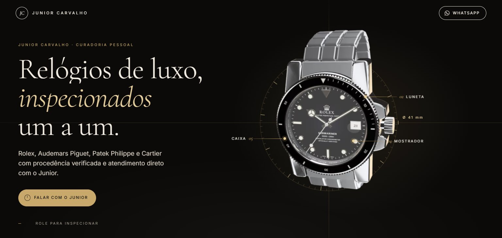

<table>
  <tr>
    <td width="50%">
      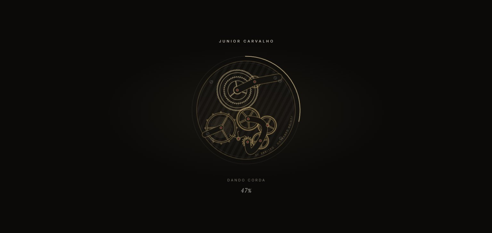
      
<b>A abertura</b> A coroa dá corda enquanto a página carrega; pronto, o movimento voa até o monograma do cabeçalho

    </td>
    <td width="50%">
      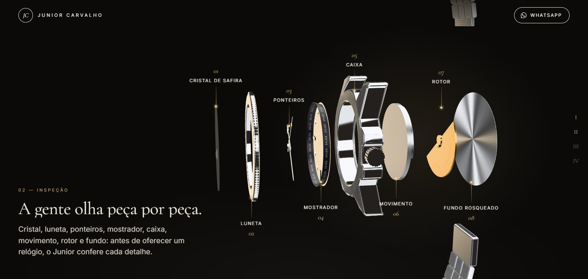
      
<b>Peça por peça</b> O Submariner se desmonta com a rolagem, com legenda em cada peça

    </td>
  </tr>
  <tr>
    <td width="50%">
      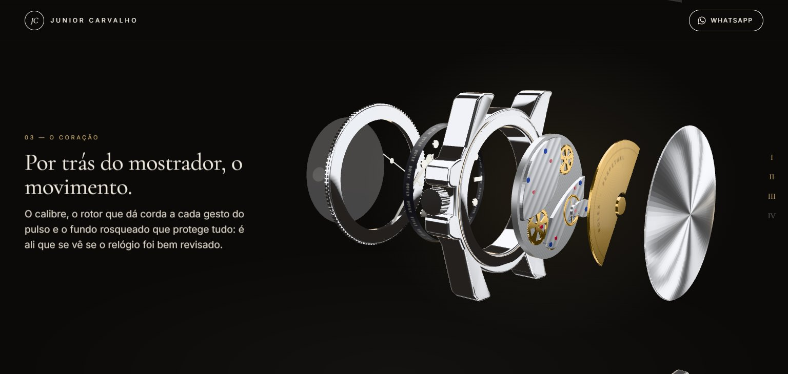
      
<b>O coração</b> Aberto, o relógio dá a volta e cada peça gira, até mostrar o movimento e o rotor

    </td>
    <td width="50%">
      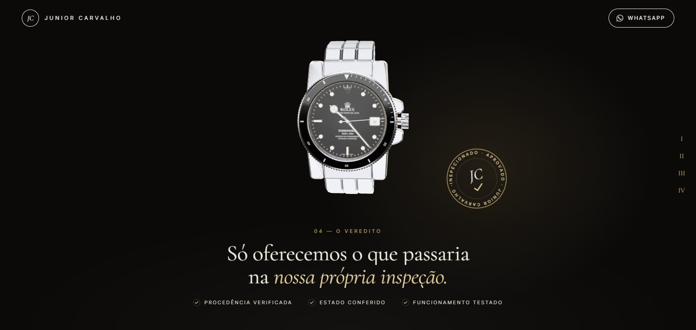
      
<b>O veredito</b> Um selo carimba a inspeção e procedência, estado e funcionamento se marcam um a um

    </td>
  </tr>
  <tr>
    <td width="50%">
      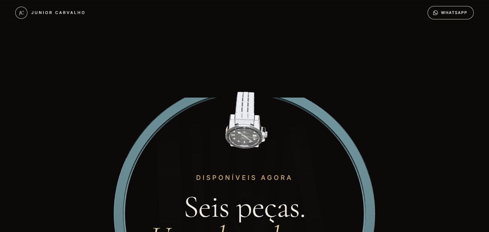
      
<b>O mergulho</b> O relógio mergulha no portal da galeria enquanto ele sobe, sem corte entre as seções

    </td>
    <td width="50%">
      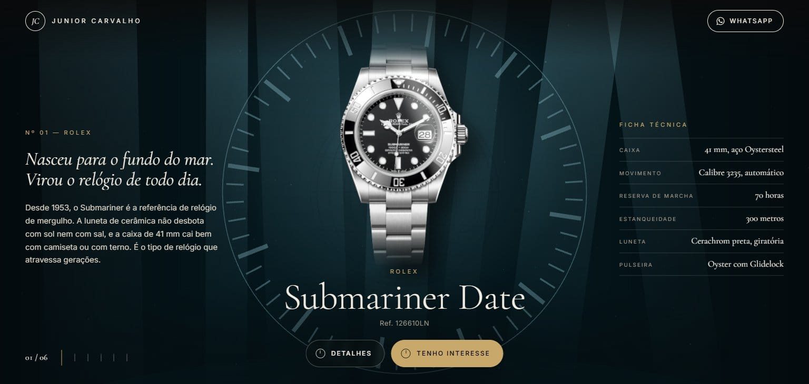
      
<b>Disponíveis</b> A foto de cada relógio na sua sala, com história e ficha técnica

    </td>
  </tr>
  <tr>
    <td width="50%">
      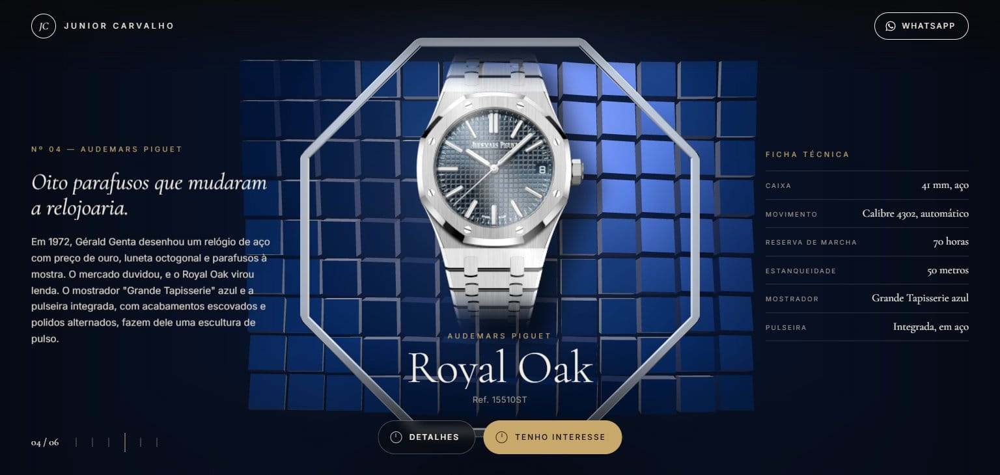
      
<b>Seis salas</b> A câmera atravessa um portal temático entre um relógio e outro

    </td>
    <td width="50%">
      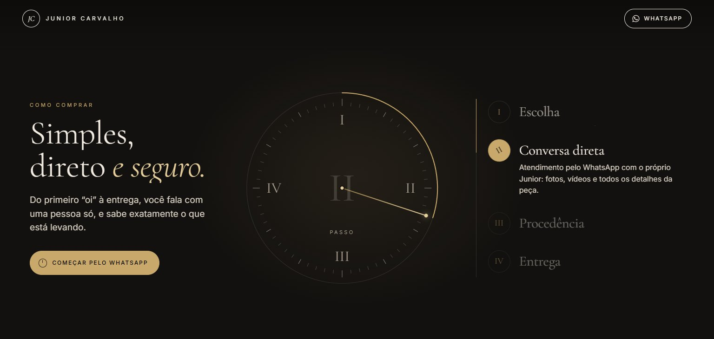
      
<b>Como comprar</b> O ponteiro avança com a rolagem, preenche a luneta e abre cada passo

    </td>
  </tr>
  <tr>
    <td width="50%">
      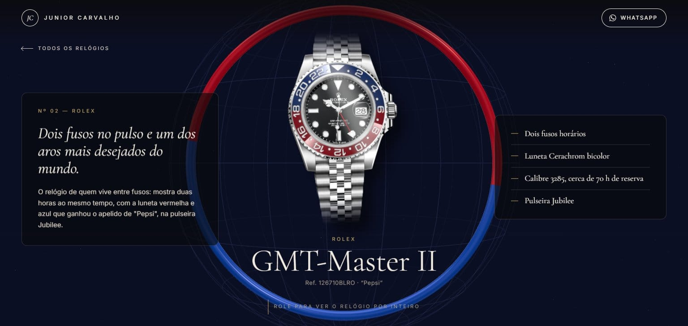
      
<b>A página de cada relógio</b> Abre na mesma sala da galeria, com o relógio no centro

    </td>
    <td width="50%">
      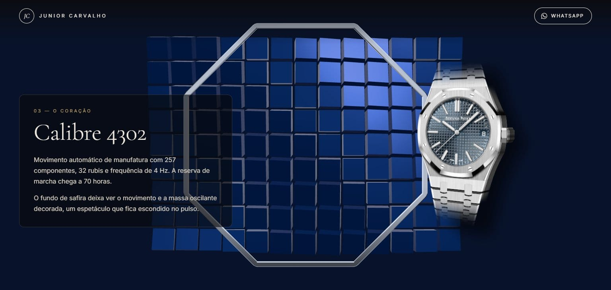
      
<b>Acompanha a rolagem</b> O relógio atravessa a sala e vira para cada texto, mostrando a espessura da caixa

    </td>
  </tr>
  <tr>
    <td width="50%">
      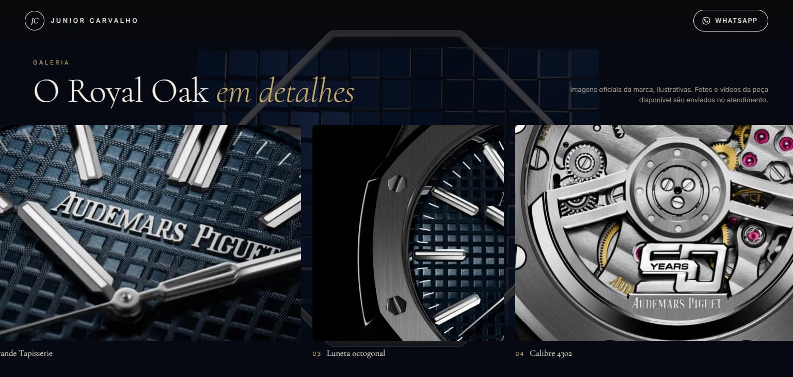
      
<b>Galeria de fotos</b> Faixa que anda com a rolagem e abre cada foto em tela cheia

    </td>
    <td width="50%">
      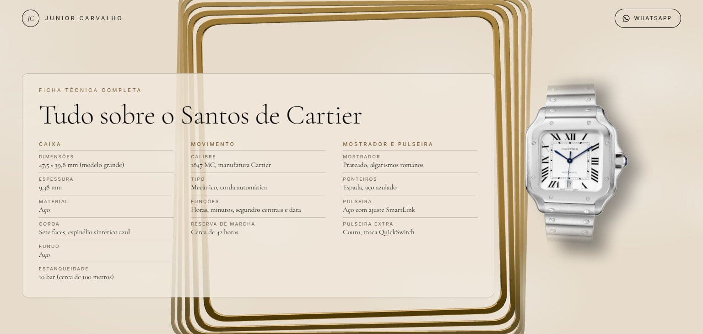
      
<b>Ficha técnica completa</b> Caixa, movimento, mostrador e pulseira, com os dados oficiais

    </td>
  </tr>
  <tr>
    <td colspan="2">
      
      
<b>Com quem você está comprando</b> Texto do Junior, números e a foto revelada numa moldura de arco

    </td>
  </tr>
</table>

### No celular

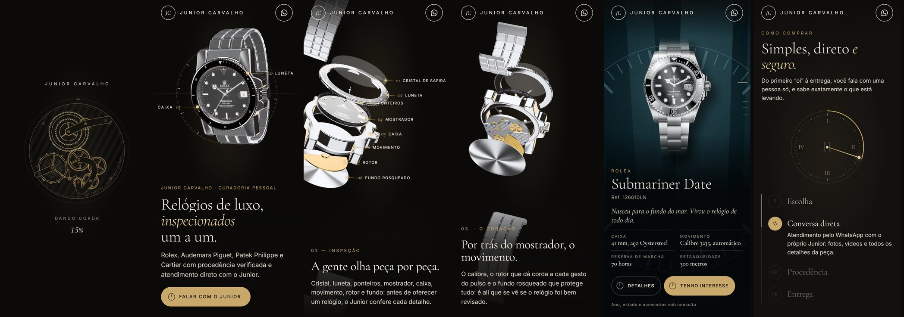

 

## Destaques

- **Um relógio só do início à galeria**: a primeira tela mostra o Submariner 3D numa ficha de inspeção, com chamadas que acompanham o 3D e reaparecem com os mesmos números na história; a rolagem afasta a câmera para a história e, no fim, o relógio mergulha no portal da galeria enquanto ele sobe, sem corte entre as seções.
- **Fotos reais nas salas**: cada relógio disponível aparece com a foto oficial do modelo, recortada e iluminada dentro da sua sala em 3D, com sombra, halo e um reflexo que passa pelo metal.
- **Uma página para cada relógio**: história, desenho, movimento e uso no pulso, galeria de fotos com ampliação e ficha técnica completa, com a foto do relógio flutuando pela sala e virando de um lado para o outro com a rolagem. Abre na mesma aba, sem recarregar: a sala da galeria continua e o relógio só muda de lugar; voltar leva de novo à sala daquele relógio.
- **Rolex Submariner 3D feito em código**: caixa Oyster com alças escovadas e flancos polidos, protetores da coroa, luneta Cerachrom, mostrador laqueado com as inscrições, rehaut gravado, lente cíclope, ponteiros Mercedes e pulseira Oyster, gerados no navegador, sem modelos baixados. Os ponteiros vão para a hora de quem visita.
- **História guiada pela rolagem**: logo depois da primeira tela, o relógio gira, se desmonta com legendas, dá a volta com cada peça girando para mostrar o movimento e o rotor por trás, e se monta de novo, de frente, para o veredito: um selo de aprovado carimba a inspeção e o checklist se marca item por item.
- **Como comprar em um mostrador**: a seção fica fixa enquanto o ponteiro passa pelos quatro passos, e a luneta se preenche exatamente até ele, abrindo o texto de cada passo.
- **Abertura curta**: um movimento mecânico desenhado em dourado (engrenagens, pontes, rubis e o balanço oscilando) enquanto a coroa dá corda; a reserva de marcha em volta enche com o carregamento real. Com a corda completa, o movimento voa até o monograma do cabeçalho enquanto o preto se dissolve, igual em qualquer página. As engrenagens giram com CSS transform, sem travar o carregamento.
- **Interesse em um toque**: cada relógio abre o WhatsApp com a mensagem pronta.
- **Leve**: a primeira tela não carrega 3D. A cena do relógio começa na primeira interação e, assim que fica pronta, as salas dos relógios disponíveis são preparadas em ordem, com a primeira sala pronta antes de a pessoa chegar nela. O relógio é montado em pequenas etapas, a iluminação vem pré-calculada (34 KB) e as fotos são WebP/AVIF no tamanho certo.
- **Mesma proporção em qualquer tela**, sem rolagem lateral, testada do celular a monitores largos.
- **Acessível**: respeita "reduzir movimento", tem navegação por teclado e textos alternativos.
- **Pronta para o Google**: metadados e imagem de compartilhamento por página, sitemap, robots e dados estruturados (organização, produtos e perguntas frequentes).

 

## Tecnologias

     

| Camada | Escolha |
| --- | --- |
| Framework | Next.js 16 (App Router), com todas as páginas geradas de forma estática |
| Interface | React 19 + TypeScript |
| 3D | Three.js com React Three Fiber |
| Animações | GSAP (ScrollTrigger e SplitText) e rolagem suave com Lenis |
| Estilos | CSS Modules |
| Imagens e fontes | `next/image` e `next/font` |
| Hospedagem | Vercel |

 

## Código-fonte

> [!NOTE]
> O código-fonte deste projeto é **privado**. Este repositório serve apenas como apresentação do trabalho.

 

## Direitos

Foto, textos, nome e marca pertencem a **Junior Carvalho**. As fotos dos relógios são imagens oficiais das marcas, usadas apenas para ilustrar os modelos. Rolex, Audemars Piguet, Patek Philippe e Cartier são marcas de seus respectivos titulares. Todos os direitos reservados: não é permitido reproduzir ou reutilizar este conteúdo sem autorização.

<!-- Desenvolvido por: Guilherme Francisco Pereira-->
